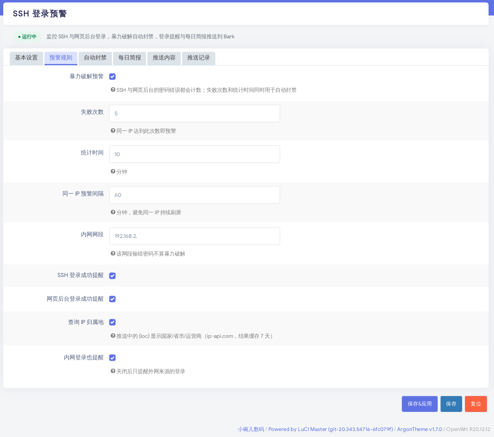
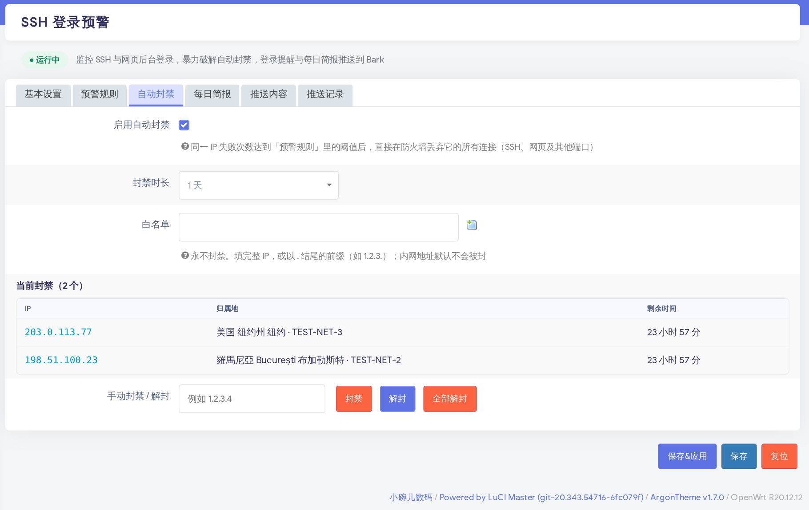
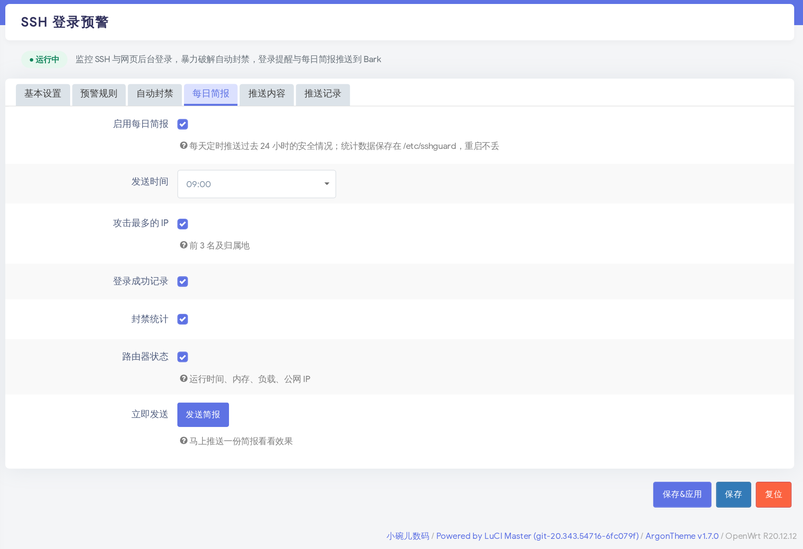
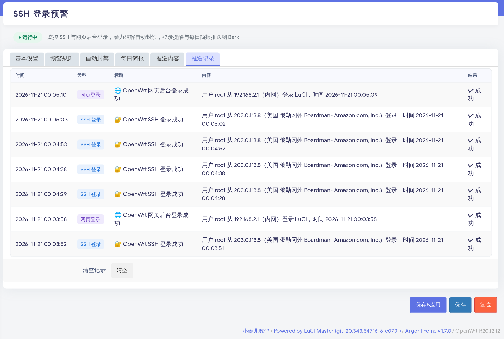

# openwrt-safedog · luci-app-sshguard

OpenWrt 路由器登录看门狗：实时监控 **SSH（dropbear）** 和 **LuCI 网页后台** 的登录，
暴力破解的 IP 自动拉黑，登录成功、攻击预警和每日安全简报通过 [Bark](https://github.com/Finb/Bark) 推送到 iPhone，推送里带 IP 归属地。

带完整的 LuCI 设置界面，所有规则和推送文案都能在网页里改，不用碰命令行。


## 功能

- **暴力破解预警**：同一 IP 在 N 分钟内密码错误达到阈值就推送，SSH 和网页后台的失败都会计数；同一 IP 可设置预警间隔，避免刷屏
- **登录成功提醒**：SSH 登录成功、网页后台登录成功分别可开关
- **自动封禁**：达到失败阈值的 IP 直接在防火墙（raw 表 + ipset）丢弃全部连接；封禁时长 1 小时～永久可选，支持白名单、手动封禁 / 解封；封禁列表重启路由器、重载防火墙后自动恢复
- **IP 归属地**：推送和封禁列表显示国家 / 省市 / 运营商（ip-api.com，缓存 7 天）
- **每日安全简报**：每天定时推送过去 24 小时的 SSH / 网页失败次数、攻击最多的前 3 个 IP 及归属地、登录成功记录、新增与当前封禁数、运行时间 / 内存 / 负载 / 公网 IP；每项可开关，可一键立即发送；统计数据存于 `/etc/sshguard`，重启不丢
- **在线更新**：界面显示当前 / 最新版本和更新内容，自己决定是否点更新；每天检查一次，有新版本推送提醒；GitHub 连不上时自动换用 jsDelivr、ghfast.top、gh-proxy.com
- **内网过滤**：可设置内网网段，内网输错密码不算暴力破解；可选择内网登录是否提醒
- **自定义推送内容**：标题、内容均可用变量自由组合
- **Bark 设置**：官方 / 自建服务器、分组、通知级别（时效性、静音也响等）、提示音、一键测试
- **自建 Bark 内网直连**：Bark 域名解析到本路由器公网 IP 时（服务器在内网、靠端口转发出去），自动按端口转发规则走内网地址，解决路由器访问不了自己公网端口的问题；也可手动指定
- **推送记录**：表格展示最近 200 条推送，含类型和发送结果，可一键清空

## 界面

| 预警规则 | 自动封禁 |
| --- | --- |
|  |  |

| 每日简报 | 推送内容 |
| --- | --- |
|  |  |



简报推送示例：

```
📊 OpenWrt 每日安全简报
🛡 攻击：SSH 失败 37 次，网页失败 2 次，来自 6 个 IP
🎯 攻击最多：
  1. 203.0.113.50（美国 纽约州 纽约 · Example ISP）18 次
  2. 198.51.100.7（荷兰 阿姆斯特丹 · Example Hosting）9 次
  3. 192.0.2.33（江苏 南京 · Chinanet）5 次
🔐 登录成功：SSH 2 次，网页 1 次
  最近：root@192.168.2.10（内网）网页 11-21 08:12
🚫 封禁：新增 4 个，当前共 7 个
📟 运行 19小时52分 · 内存 29% · 负载 0.39
🌍 公网 IP：x.x.x.x
```

## 安装

适用于使用 Lua LuCI（含 `luci-compat`）的 OpenWrt，例如 Lean / LEDE 源码编译的 R20.x、R21.x，OpenWrt 19.07、21.02。架构无关（`all`），任何 CPU 都能装。

1. 到 [Releases](https://github.com/yeyinghai/openwrt-safedog/releases) 下载 `luci-app-sshguard_*_all.ipk`
2. 上传到路由器并安装：

```sh
opkg update
opkg install curl luci-compat ipset iptables   # 已装可跳过
opkg install /tmp/luci-app-sshguard_*_all.ipk
```

也可以在「系统 → 软件包 → 上传软件包」里直接装。

3. 刷新后台，进入 **服务 → SSH 登录预警**，填写 Bark 地址，勾选「启用」，点「保存&应用」，再点「发送测试消息」确认手机能收到。

升级时直接安装新版本，已填写的配置会保留。卸载：`opkg remove luci-app-sshguard`。

## 推送变量

| 变量 | 含义 |
| --- | --- |
| `{host}` | 路由器主机名 |
| `{ip}` | 来源 IP |
| `{user}` | 登录用户名（网页失败显示为 `root（网页）`） |
| `{count}` | 统计时间内失败次数 |
| `{minutes}` | 统计时间（分钟） |
| `{loc}` | IP 归属地（内网显示「内网」） |
| `{ban}` | 封禁说明，如「已自动封禁 1 天」（未封禁为空） |
| `{time}` | 当前时间 |

## 工作原理

- `/usr/bin/sshguard.sh` 由 procd 守护，读取 `logread -f` 实时日志：
  - `dropbear ... Bad password attempt` / `Login attempt for nonexistent user` 计为失败
  - `dropbear ... auth succeeded` 计为 SSH 登录成功
- LuCI 默认不记录登录日志，安装时 `sshguard-luci-hook` 会在 `/usr/lib/lua/luci/dispatcher.lua` 的登录处插入一行，写入 syslog：
  `luci: accepted|failed login for <用户> from <IP>`。插入前会备份并做语法检查，失败自动还原；服务每次启动都会检查并补回（升级 luci-base 后不需要手动处理），卸载时自动移除
- 封禁：`ipset` 集合 `sshguard_ban`（自带超时）+ `iptables -t raw -I PREROUTING -m set --match-set sshguard_ban src -j DROP`，在 DNAT 之前丢弃，端口转发进来的连接同样拦截；通过 firewall include 在防火墙重载后恢复，封禁列表保存到 `/etc/sshguard/ban.save`
- 每日简报：写入 `/etc/crontabs/root`，事件记录在 `/etc/sshguard/events.log`（自动截断）
- 推送通过 `curl` POST JSON 到 Bark

配置文件：`/etc/config/sshguard`；运行数据与推送记录：`/tmp/sshguard/`（重启清空）。

## 命令行

```sh
/usr/bin/sshguard.sh test          # 发送测试推送并输出结果
/usr/bin/sshguard.sh report        # 立即发送每日简报
/usr/bin/sshguard.sh bans          # 查看封禁列表（IP 剩余秒数）
/usr/bin/sshguard.sh ban 1.2.3.4   # 手动封禁
/usr/bin/sshguard.sh unban 1.2.3.4 # 解封（unban all 全部解封）
/usr/bin/sshguard.sh geo 1.2.3.4   # 查询归属地
/usr/bin/sshguard-update check     # 检查新版本
/usr/bin/sshguard-update start     # 后台下载并安装新版本（日志 /tmp/sshguard/update.log）
/etc/init.d/sshguard restart       # 重启服务
logread | grep -E "dropbear|luci:" # 查看登录日志
```

## 自己构建 ipk

**方式一：打包脚本（推荐，无需 SDK）**

```sh
git clone https://github.com/yeyinghai/openwrt-safedog.git
cd openwrt-safedog
./build.sh
# 生成 dist/luci-app-sshguard_<版本>_all.ipk
```

**方式二：GitHub Actions**

先改 `Makefile` 版本号、在 `CHANGELOG.md` 写更新内容并运行 `./release.sh` 生成 `version.json`，提交后推送 `v*` 标签（如 `git tag v1.4.1 && git push origin v1.4.1`）会自动构建并发布到 Releases；也可在 Actions 页面手动运行，从 Artifacts 下载。

**方式三：OpenWrt SDK / 源码树**

```sh
cp -r luci-app-sshguard <openwrt>/package/
make menuconfig     # LuCI -> 3. Applications -> luci-app-sshguard
make package/luci-app-sshguard/compile V=s
```

## 目录结构

```
luci-app-sshguard/
├── Makefile                         # OpenWrt SDK 编译用
├── control/                         # build.sh 用的安装脚本
└── root/
    ├── etc/config/sshguard          # 默认配置
    ├── etc/init.d/sshguard          # procd 服务
    ├── etc/uci-defaults/luci-sshguard
    ├── usr/bin/sshguard.sh          # 监控与推送主程序
    ├── usr/bin/sshguard-luci-hook   # LuCI 登录日志补丁
    ├── usr/share/sshguard/firewall.include  # 防火墙重载后恢复封禁
    └── usr/lib/lua/luci/
        ├── controller/sshguard.lua
        └── model/cbi/sshguard.lua   # 设置界面
build.sh                             # 一键打包 ipk
```

## 注意

开启自动封禁后，你自己在外网连续输错密码达到阈值也会被封。建议把常用的外网 IP 加入白名单；被封后可从内网或 ZeroTier 等内网通道登录后台解封，或在路由器上执行 `sshguard.sh unban all`。

## 更新记录

见 [CHANGELOG.md](CHANGELOG.md)。
