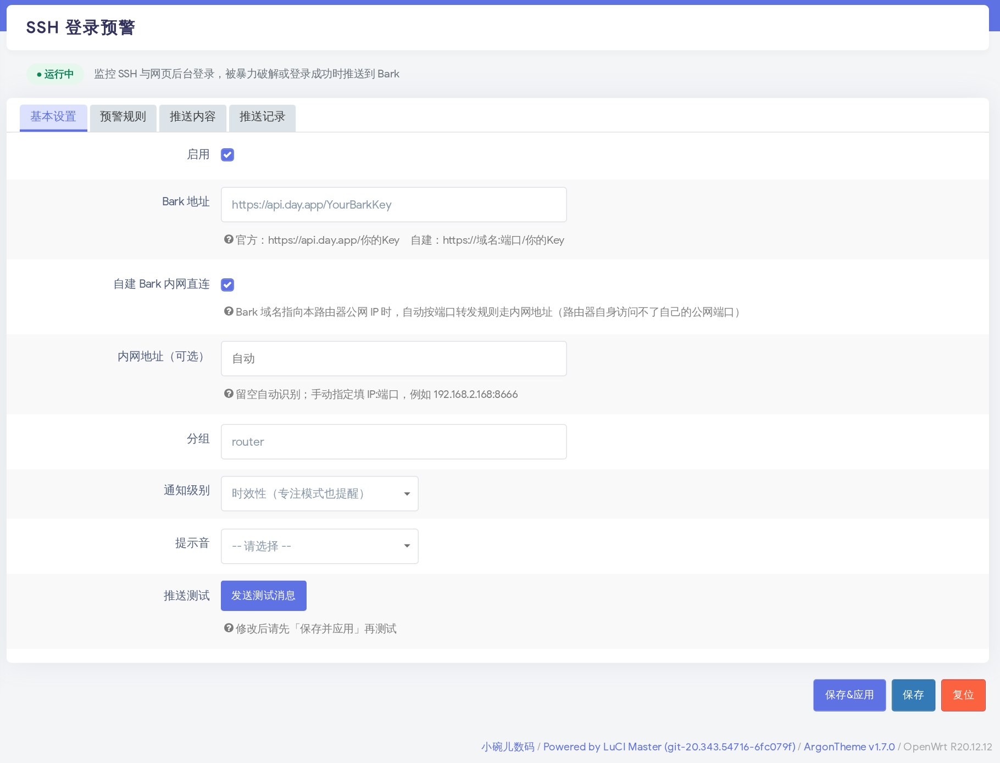
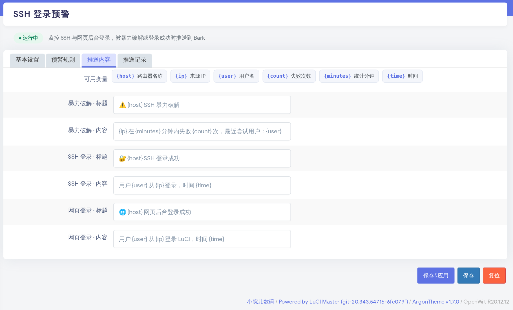

# openwrt-safedog · luci-app-sshguard

OpenWrt 路由器登录看门狗：实时监控 **SSH（dropbear）** 和 **LuCI 网页后台** 的登录，
发现暴力破解或登录成功时，通过 [Bark](https://github.com/Finb/Bark) 推送到 iPhone。

带完整的 LuCI 设置界面，所有规则和推送文案都能在网页里改，不用碰命令行。



## 功能

- **暴力破解预警**：同一 IP 在 N 分钟内密码错误达到阈值就推送，SSH 和网页后台的失败都会计数；同一 IP 可设置预警间隔，避免刷屏
- **登录成功提醒**：SSH 登录成功、网页后台登录成功分别可开关
- **内网过滤**：可设置内网网段，内网输错密码不算暴力破解；可选择内网登录是否提醒
- **自定义推送内容**：标题、内容均可用变量自由组合
- **Bark 设置**：官方 / 自建服务器、分组、通知级别（时效性、静音也响等）、提示音、一键测试
- **自建 Bark 内网直连**：Bark 域名解析到本路由器公网 IP 时（服务器在内网、靠端口转发出去），自动按端口转发规则走内网地址，解决路由器访问不了自己公网端口的问题；也可手动指定
- **推送记录**：表格展示最近 200 条推送，含类型和发送结果，可一键清空

## 界面

| 预警规则 | 推送内容 |
| --- | --- |
|  |  |


## 安装

适用于使用 Lua LuCI（含 `luci-compat`）的 OpenWrt，例如 Lean / LEDE 源码编译的 R20.x、R21.x，OpenWrt 19.07、21.02。架构无关（`all`），任何 CPU 都能装。

1. 到 [Releases](https://github.com/yeyinghai/openwrt-safedog/releases) 下载 `luci-app-sshguard_*_all.ipk`
2. 上传到路由器并安装：

```sh
opkg update
opkg install curl luci-compat      # 已装可跳过
opkg install /tmp/luci-app-sshguard_*_all.ipk
```

也可以在「系统 → 软件包 → 上传软件包」里直接装。

3. 刷新后台，进入 **服务 → SSH 登录预警**，填写 Bark 地址，勾选「启用」，点「保存&应用」，再点「发送测试消息」确认手机能收到。

升级时直接安装新版本，已填写的配置会保留。卸载：`opkg remove luci-app-sshguard`。

## 推送变量

| 变量 | 含义 |
| --- | --- |
| `{host}` | 路由器主机名 |
| `{ip}` | 来源 IP |
| `{user}` | 登录用户名（网页失败显示为 `root（网页）`） |
| `{count}` | 统计时间内失败次数 |
| `{minutes}` | 统计时间（分钟） |
| `{time}` | 当前时间 |

## 工作原理

- `/usr/bin/sshguard.sh` 由 procd 守护，读取 `logread -f` 实时日志：
  - `dropbear ... Bad password attempt` / `Login attempt for nonexistent user` 计为失败
  - `dropbear ... auth succeeded` 计为 SSH 登录成功
- LuCI 默认不记录登录日志，安装时 `sshguard-luci-hook` 会在 `/usr/lib/lua/luci/dispatcher.lua` 的登录处插入一行，写入 syslog：
  `luci: accepted|failed login for <用户> from <IP>`。插入前会备份并做语法检查，失败自动还原；服务每次启动都会检查并补回（升级 luci-base 后不需要手动处理），卸载时自动移除
- 推送通过 `curl` POST JSON 到 Bark

配置文件：`/etc/config/sshguard`；运行数据与推送记录：`/tmp/sshguard/`（重启清空）。

## 命令行

```sh
/usr/bin/sshguard.sh test          # 发送测试推送并输出结果
/etc/init.d/sshguard restart       # 重启服务
logread | grep -E "dropbear|luci:" # 查看登录日志
```

## 自己构建 ipk

**方式一：打包脚本（推荐，无需 SDK）**

```sh
git clone https://github.com/yeyinghai/openwrt-safedog.git
cd openwrt-safedog
./build.sh
# 生成 dist/luci-app-sshguard_<版本>_all.ipk
```

**方式二：GitHub Actions**

推送 `v*` 标签（如 `git tag v1.2.0 && git push origin v1.2.0`）会自动构建并发布到 Releases；也可在 Actions 页面手动运行，从 Artifacts 下载。

**方式三：OpenWrt SDK / 源码树**

```sh
cp -r luci-app-sshguard <openwrt>/package/
make menuconfig     # LuCI -> 3. Applications -> luci-app-sshguard
make package/luci-app-sshguard/compile V=s
```

## 目录结构

```
luci-app-sshguard/
├── Makefile                         # OpenWrt SDK 编译用
├── control/                         # build.sh 用的安装脚本
└── root/
    ├── etc/config/sshguard          # 默认配置
    ├── etc/init.d/sshguard          # procd 服务
    ├── etc/uci-defaults/luci-sshguard
    ├── usr/bin/sshguard.sh          # 监控与推送主程序
    ├── usr/bin/sshguard-luci-hook   # LuCI 登录日志补丁
    └── usr/lib/lua/luci/
        ├── controller/sshguard.lua
        └── model/cbi/sshguard.lua   # 设置界面
build.sh                             # 一键打包 ipk
```
